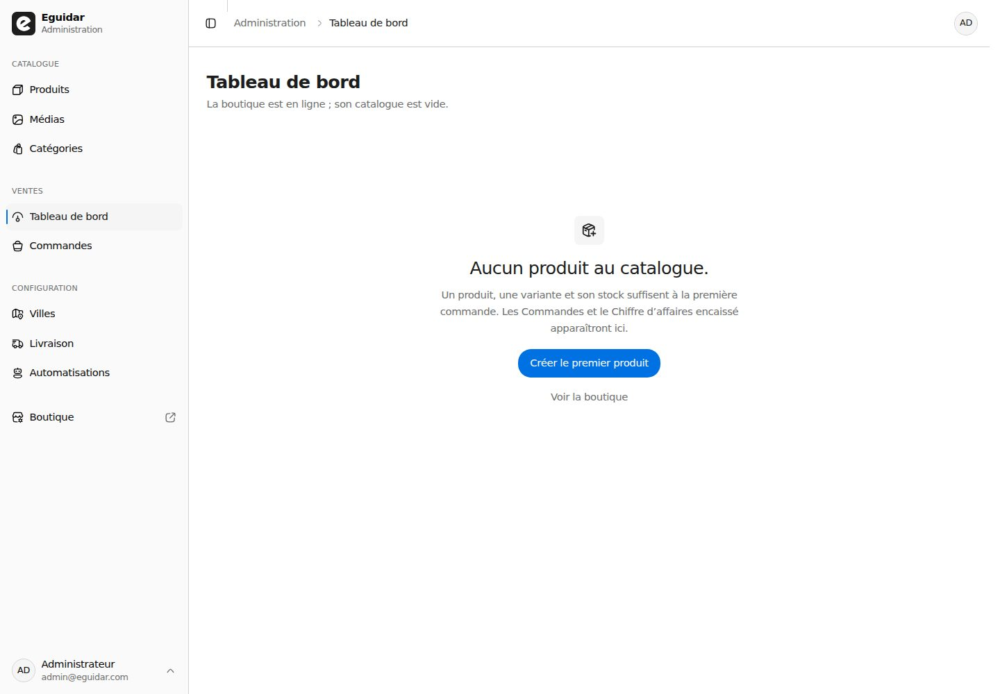
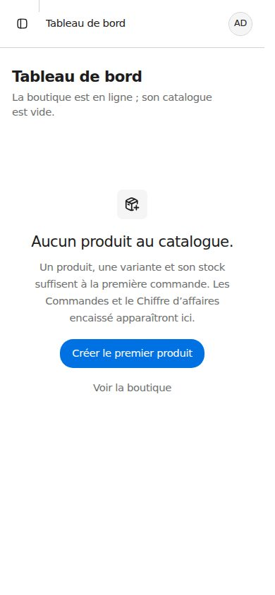
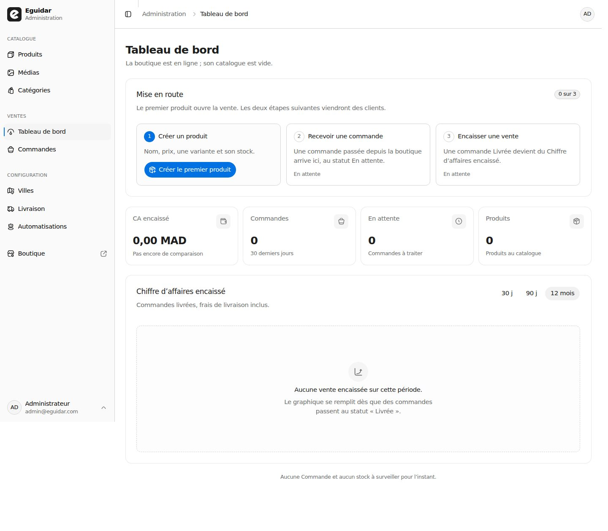
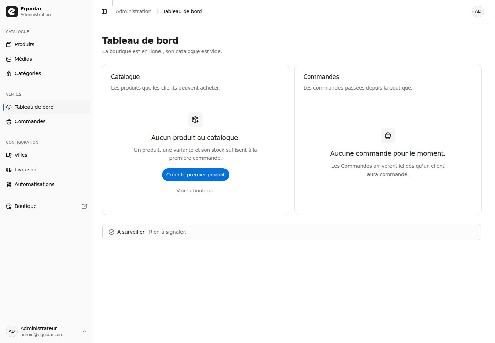
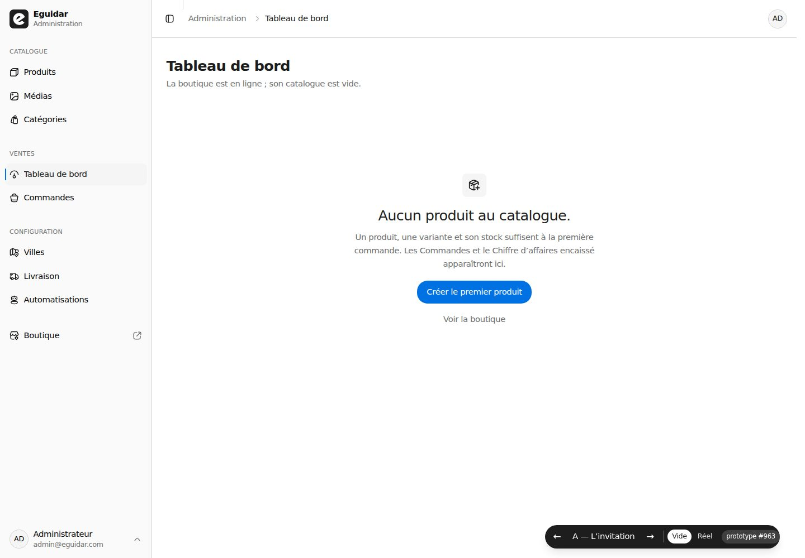

# Prototype — la première page du Tableau de bord

**Jetable : ce n'est pas du code à garder.** La route `/admin` porte trois lectures de la boutique
vide, commutées par la barre de bas d'écran (`?variant=A|B|C`), contre le Tableau de bord réel
(`?etat=reel`). Le défaut en développement est `?etat=vide&variant=A`.

## Verdict — 8 novembre 2026 (#963)

**A — « L'invitation » gagne.** La page entière cède la place à une seule invitation : pas de
rangée d'indicateurs à zéro, pas de graphique, pas de période, pas de tableaux, pas d'_À
surveiller_. Un titre, une phrase qui dit ce qui manque et ce que le premier produit débloque,
une action primaire, un lien secondaire vers la boutique.

Ce qui décide :

- **A est la seule qui ne répète pas l'absence.** B dit « rien » à chaque bande — quatre zéros,
  un graphique vide, une période qui ne change rien — et mesure **1 902 px** à 390 px, contre
  **844 px** pour A. C dit « rien » deux fois (Catalogue, Commandes) et sa carte Commandes, sans
  action, ajoute **390 px** de page pour un état passif.
- **A fait du premier produit l'unique geste.** C partage l'attention entre deux portes dont une
  est passive ; B garde le cadre du Tableau de bord et ajoute un chemin, si bien que le premier
  produit est une étape parmi quatre blocs. A n'a qu'un bouton.
- **La copie de C est la meilleure et elle est reprise par A** : « Un produit, une variante et son
  stock suffisent à la première commande. » C'est la réponse à « le premier pas qui débloque
  vraiment une vente », pas « Nouveau produit ».
- **Le graphique et sa période n'ont rien à faire ici.** `Aucune vente encaissée sur cette
période` est l'état du graphique d'un Tableau de bord qui a des produits mais pas encore de
  vente livrée ; ce n'est pas l'état d'une boutique vide. Une période sans Commande n'a rien à
  comparer : B le montre, les trois liens sont cliquables et ne changent que leur propre
  surbrillance.

**B et C sont refusées**, mais restent lisibles ici : la carte « Mise en route » et les quatre
zéros de B, les deux portes et le bandeau « À surveiller — Rien à signaler » de C.

## Ce que le ticket demandait de trancher

| Question                                                             | Réponse                                                                                                                                                                                                                                                    |
| -------------------------------------------------------------------- | ---------------------------------------------------------------------------------------------------------------------------------------------------------------------------------------------------------------------------------------------------------- |
| La rangée de KPI rend-elle quatre zéros ?                            | **Non.** Elle cède la place à une invitation unique ; aucune carte d'indicateur n'est rendue.                                                                                                                                                              |
| Le graphique garde-t-il `Aucune vente encaissée sur cette période` ? | **Pas sur la première page.** La carte graphique, sa description et la période ne sont pas rendues. L'état vide du graphique reste celui du Tableau de bord de travail, pour une boutique qui a des produits mais aucune vente livrée sur la fenêtre.      |
| Une période a-t-elle un sens avant qu'il y ait à comparer ?          | **Non.** Pas de `30 j / 90 j / 12 mois` sur la première page. Le build ne rend le sélecteur qu'à partir de la première Commande ; le seuil exact revient à #964 si l'en-tête du graphique change.                                                          |
| Les deux tableaux deviennent-ils une invitation ?                    | **Oui, une seule.** _Commandes récentes_ et _Stock faible_ ne sont pas rendus ; _À surveiller_ non plus. La première page n'a aucune liste.                                                                                                                |
| Quelle action primaire ?                                             | **« Créer le premier produit »**, vers `/admin/produits/nouveau` — pas « Nouveau produit » seul. Le titre de l'en-tête ne porte plus l'action ; l'invitation est le seul point d'entrée.                                                                   |
| Quel primitif porte l'état ?                                         | **`components/ui/empty.tsx`** (`Empty`, `EmptyHeader`, `EmptyMedia`, `EmptyTitle`, `EmptyDescription`, `EmptyContent`). Le `components/admin/empty-state.tsx` local reste l'idiome des intérieurs de liste et de carte ; il n'apparaît pas sur cette page. |

## La page retenue, champ par champ

- **Titre** : `Tableau de bord` — il ne change pas, la navigation et le fil d'Ariane le nomment
  déjà ainsi.
- **Description de l'en-tête** : « La boutique est en ligne ; son catalogue est vide. » Elle dit
  l'état, elle ne promet pas des chiffres qui n'existent pas.
- **Titre de l'invitation** : « Aucun produit au catalogue. »
- **Description** : « Un produit, une variante et son stock suffisent à la première commande. Les
  Commandes et le Chiffre d'affaires encaissé apparaîtront ici. » — le minimum achetable, puis ce
  que la page deviendra.
- **Action primaire** : « Créer le premier produit » (`/admin/produits/nouveau`).
- **Action secondaire** : « Voir la boutique » (`/`), un lien texte discret.
- **Déclencheur** : `productCount === 0 && orderCount === 0` — l'état 0 / 0 / 0 du ticket. Les deux
  compteurs existent déjà dans `getDashboardStats()` ; aucun champ à ajouter. Une boutique qui a
  des produits mais aucune Commande affiche le Tableau de bord de travail ; une boutique qui n'a
  plus de produit mais garde des Commandes aussi (elle a une histoire).
- **Après le premier produit** : la page redevient le Tableau de bord de travail. Le produit
  enregistré ouvre `/admin/produits/:id` ; au retour, la première page a disparu.
- **Mouvement** : aucun. L'état rare pourrait porter plus de soin, mais la page est un point de
  départ, pas une célébration ; le feedback d'appui des boutons reste le seul mouvement.
- **Responsive** : à 390 px, l'invitation tient dans un écran (844 px), le bouton est visible sans
  défilement, la description passe sur quatre lignes. À 768 px, la colonne de contenu fait 512 px
  et l'invitation reste centrée. À 1440 px, elle est centrée dans la page, sans carte autour.
- **Primitif** : `Empty` sans bordure ni boîte ; `EmptyMedia variant="icon"`, `EmptyTitle` agrandi
  (`text-xl sm:text-2xl`), `EmptyContent` avec le bouton et le lien. Le prototype surcharge la
  taille du titre et la hauteur minimale ; le build doit exposer une taille de page plutôt que
  recopier ces surcharges.

## Les trois variantes, mesurées

| Variante                 | 390 px | 768 px | 1440 px | Ce qu'elle dit                                                               |
| ------------------------ | ------ | ------ | ------- | ---------------------------------------------------------------------------- |
| **A — L'invitation**     | 844    | 1 024  | 1 000   | Une invitation, une action.                                                  |
| **B — La mise en route** | 1 902  | 1 789  | 1 259   | Chemin en trois étapes, quatre KPI à zéro, graphique vide et période.        |
| **C — Les deux portes**  | 1 309  | 1 182  | 1 000   | Catalogue et Commandes côte à côte, puis « À surveiller — Rien à signaler. » |

Les hauteurs sont celles des captures pleine page, barre de prototype masquée. Le Tableau de bord
réel (`?etat=reel`) mesure 1 466 px à 1440 px avec les données semées.

### A — L'invitation





### B — La mise en route



### C — Les deux portes



### La barre de prototype



## Ce que le prototype a découvert

- **Les quatre zéros ne coûtent pas une rangée, ils coûtent la page.** À 390 px, B est deux fois
  plus longue que A ; le graphique seul prend 500 px, et `Aucune vente encaissée sur cette
période` est le plus gros texte de la page.
- **`ui/empty` n'a pas de taille de page.** `EmptyTitle` est en `text-lg`, `Empty` a `p-12` ; le
  prototype agrandit le titre et pose `min-h-[52svh]`. Le build doit décider si c'est une
  variante (`size="page"`) ou des classes locales, plutôt que laisser deux recettes.
- **Le point de rupture de la grille du Tableau de bord est `lg`, pas `md`.** À 768 px, la barre
  latérale laisse 512 px : trois étapes en `md:grid-cols-3` ne tiennent pas, deux portes non
  plus. Les variantes utilisent `lg:grid-cols-3` / `lg:grid-cols-2`.
- **La barre de prototype doit éviter le pied de la barre latérale à 768 px** ; elle se pose en
  bas à droite dès `md`, centrée en dessous. C'est un détail du prototype, pas de la page.
- **L'état vide du graphique est déjà écrit** et il est bon (`revenue-chart.tsx:36-55`) ; il n'a
  pas besoin d'une troisième formulation sur la première page. Il reste pour la boutique qui a
  des produits et pas encore de vente livrée.

## Ce que le prototype ne pouvait pas juger

- **La vraie base vide.** Les variantes rendent des zéros écrits en dur ; la base de
  développement a 10 produits et 2 Commandes. Le build doit vérifier la première page contre une
  base qui n'a que le Socle (`prisma/seed.ts` ne sème ni Catalogue ni Blog), et confirmer que
  `productCount` / `orderCount` déclenchent bien le basculement.
- **L'état intermédiaire** : 1 produit, 0 Commande. Le Tableau de bord de travail y garde son
  graphique et sa période ; c'est le sujet de #964, pas de ce ticket.
- **Le mode sombre.** Les captures sont en clair ; les composants n'emploient que des jetons du
  thème, sauf le vert/ambre des alertes du Tableau de bord réel, qui ne sont pas sur cette page.
- **La place du déclencheur dans l'architecture.** Le prototype lit `productCount` et `orderCount`
  dans la page, déjà chargés par `getDashboardStats()`. Le build peut garder la décision dans la
  page (elle n'appelle pas Prisma) ou la nommer dans le cas d'usage ; les deux respectent la
  couture.
- **La transition après l'enregistrement.** Le produit ouvre sa fiche, pas le Tableau de bord ; la
  première page ne se revoit qu'au retour. Le prototype ne juge pas ce détour.

## Comment le lancer

```bash
npm run dev
```

Se connecter avec le compte administrateur, puis ouvrir `/admin`. La barre du bas commute
`A / B / C` (ou `←` / `→` sur le clavier) et `Vide / Réel`. Le prototype s'affiche par défaut en
développement ; `?etat=reel` rend le Tableau de bord d'aujourd'hui. La barre et la première page
sont montées seulement quand `NODE_ENV === "development"` : une production ne peut pas les
atteindre par un paramètre d'URL.

Les captures sont faites à 390 × 844, 768 × 1024 et 1440 × 1000, barre et outils de développement
masqués ; `barre-1440.jpg` montre la barre. Aucune donnée n'est modifiée.

## Fichiers

Tout le prototype vit dans `app/admin/_prototype-premiere-page/` (dossier privé de l'App Router) :

- `premiere-page.tsx` — le choix de la variante ;
- `variante-a.tsx`, `variante-b.tsx`, `variante-c.tsx` ;
- `selecteur.tsx` — la barre de bas d'écran ;
- `variantes.ts`, `etats.ts`, `periodes.ts` — les clés et l'URL, rien de plus ;
- `captures/` — les images ci-dessus.

`app/admin/page.tsx` ne change que par le paramètre `?etat` et la barre ; le Tableau de bord réel
n'est pas réécrit.
