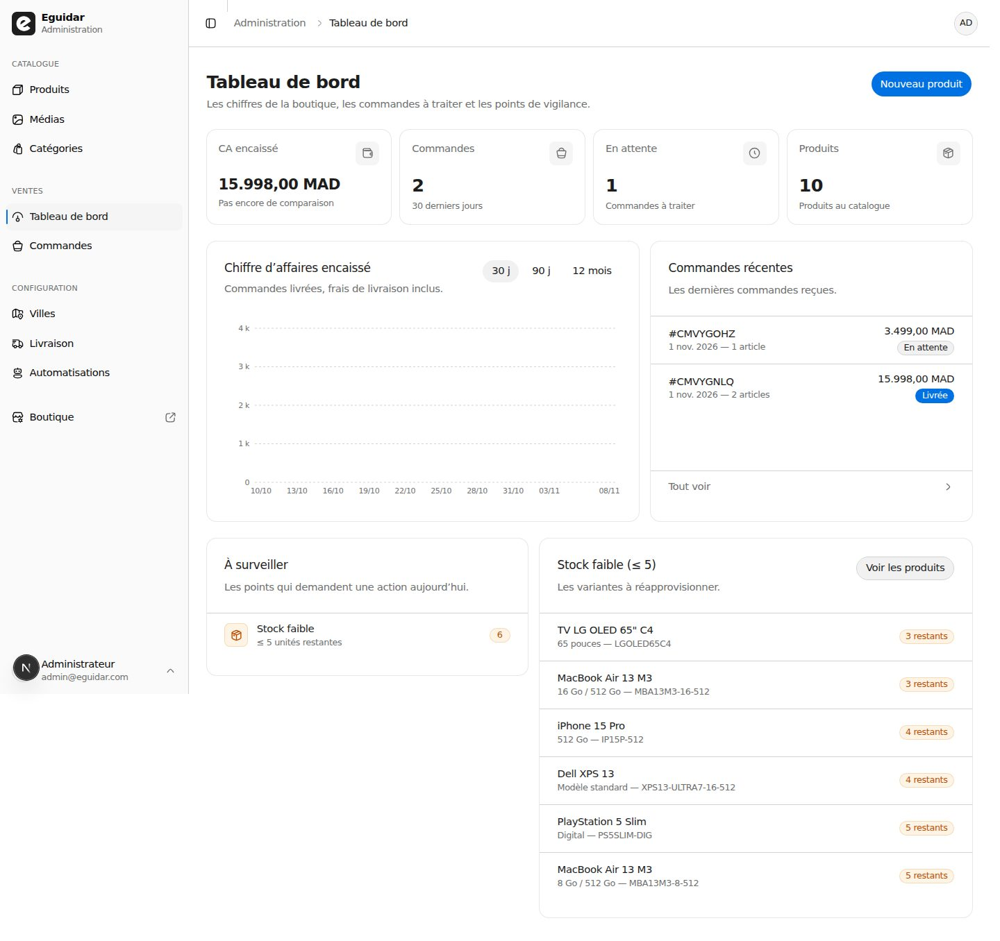
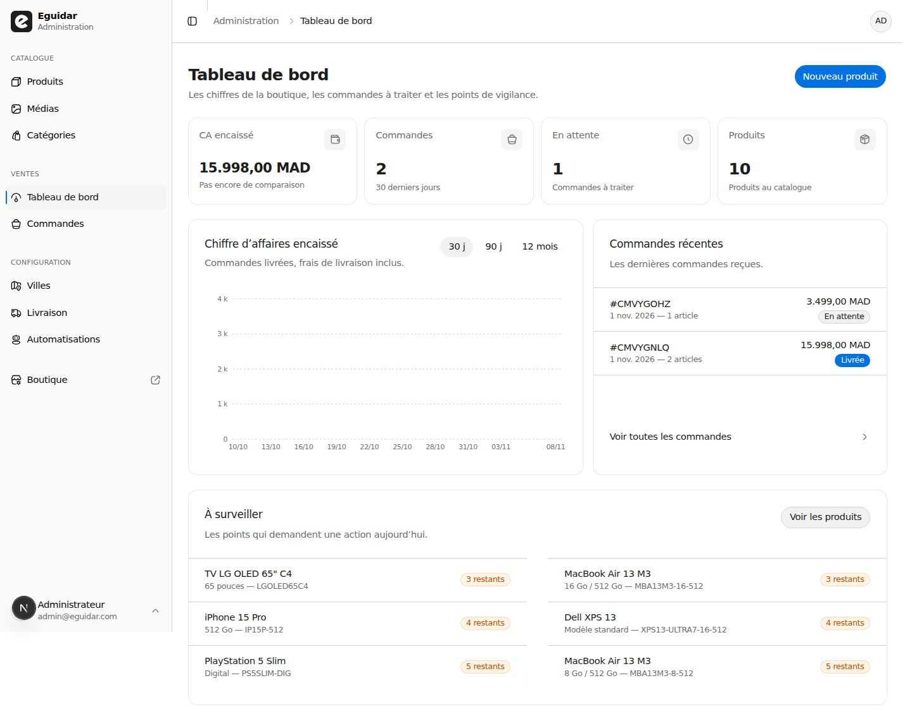
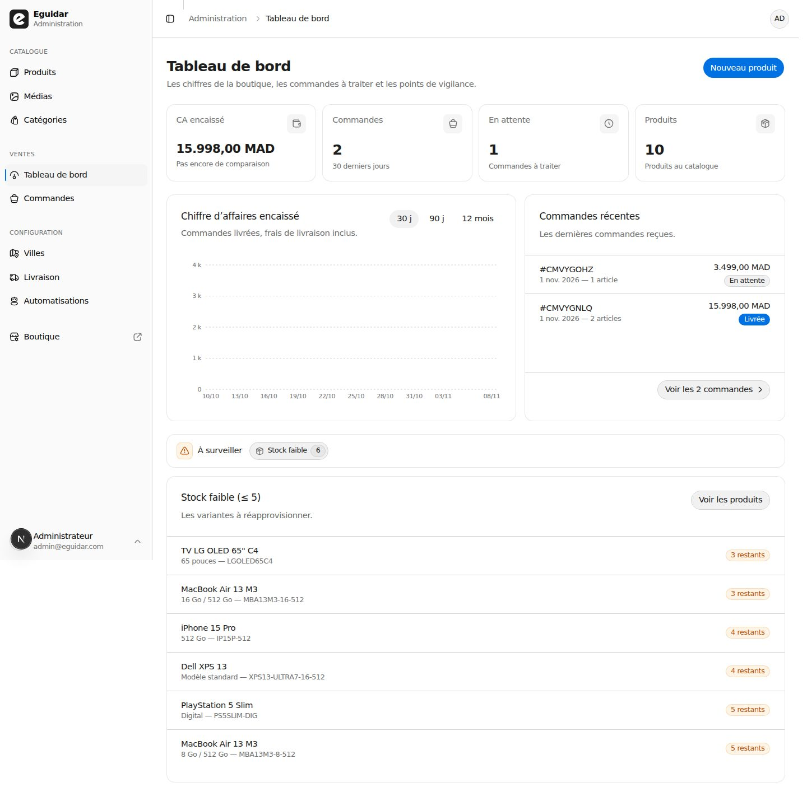
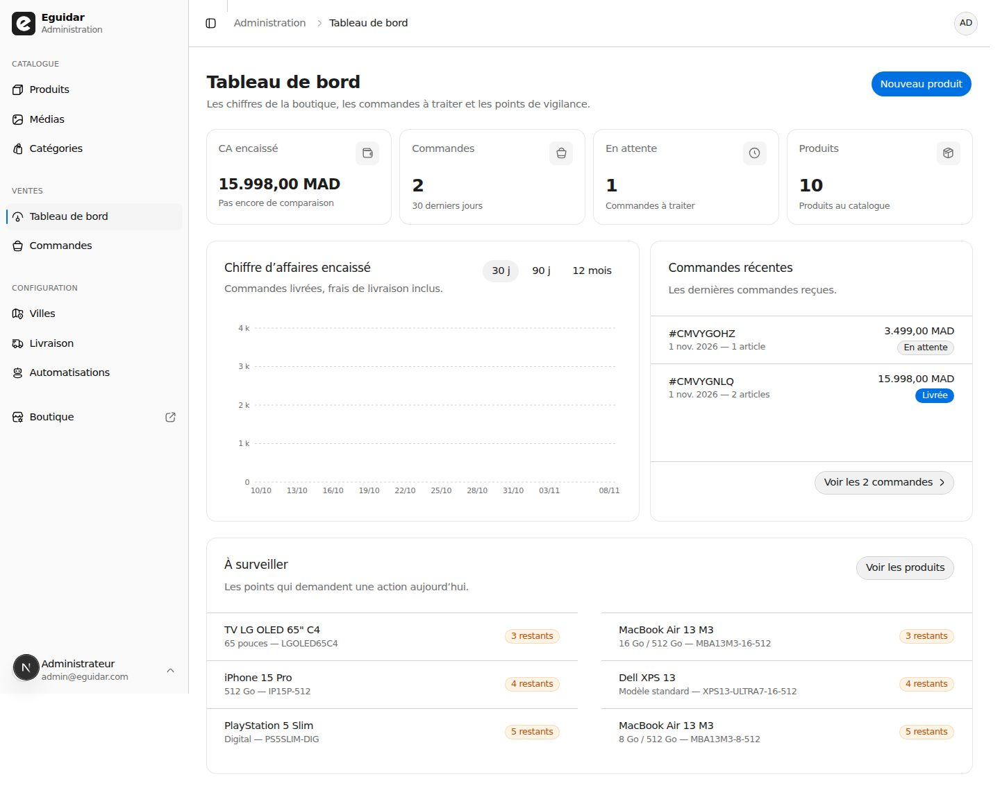
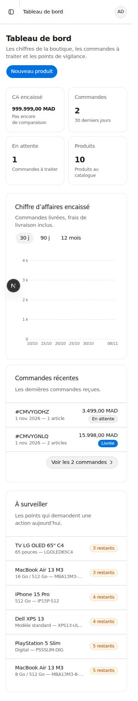
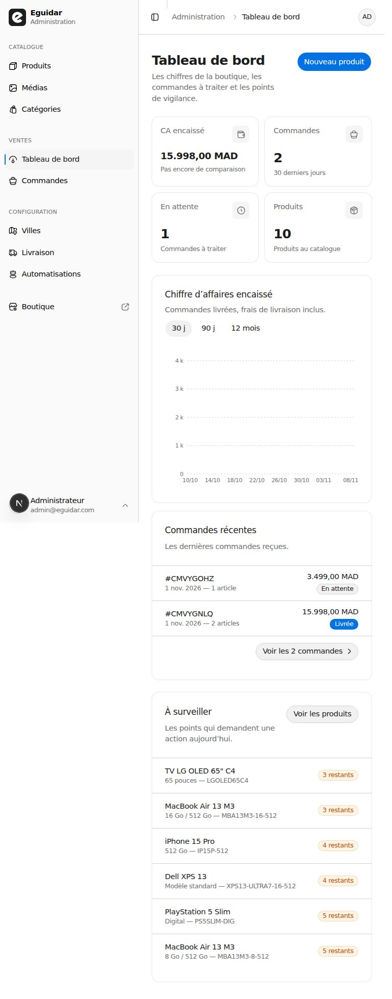
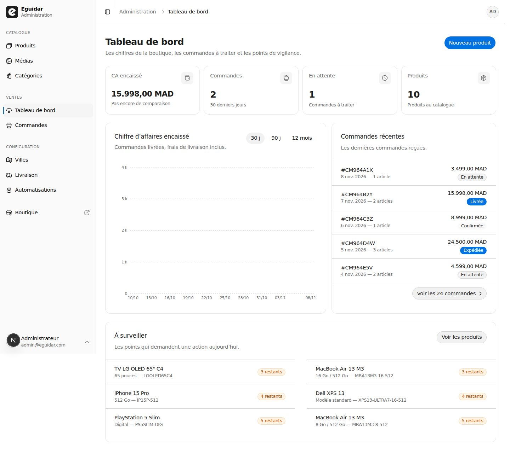
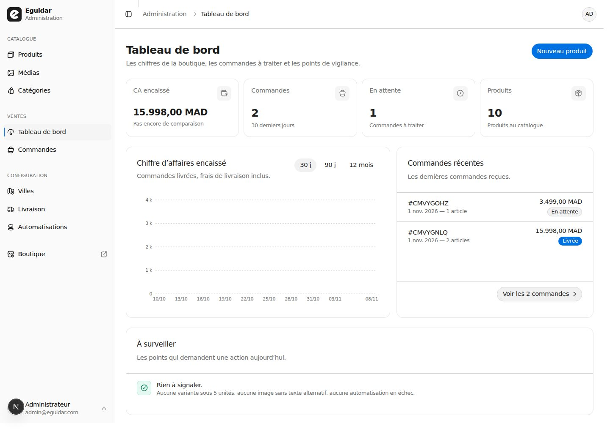
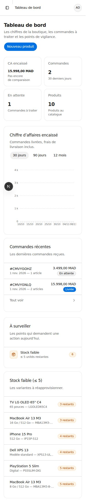
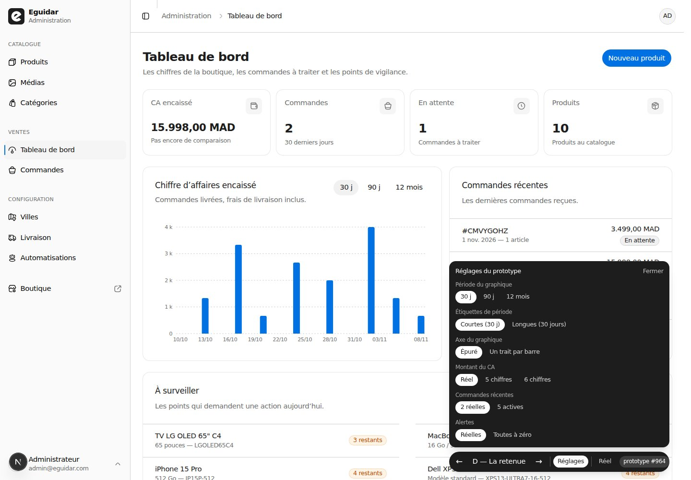

# Prototype — le Tableau de bord refacturé, à 390 / 768 / 1440

**Jetable : ce n'est pas du code à garder.** La route `/admin` porte quatre lectures du Tableau de
bord, commutées par la barre de bas d'écran (`?variant=A|B|C|D`), contre la page d'aujourd'hui
(`?variant=reel`). Le défaut en développement est **D — La retenue** ; A, B et C restent les
expériences qui l'ont composée. Aucune donnée n'est écrite : les fenêtres de 30 et 90 jours sont
synthétiques, les cinq Commandes du scénario « boutique active » aussi.

## Verdict — 8 novembre 2026 (#964)

**D — « La retenue » gagne.** Ce n'est pas une quatrième idée : c'est la composition des trois
autres, et c'est la page que #965 doit construire.

- **A — Le contrat** fournit le bandeau 4/7 + 3/7, le graphique à 260 px de hauteur minimale et la
  liste des Commandes qui s'étire.
- **C — La bande** fournit le pied de carte : un bouton qui nomme le nombre de Commandes.
- **B — Le guichet** fournit la troisième bande fusionnée en une seule carte « À surveiller », en
  deux colonnes sur `lg` ; c'est ce qui referme le vide de la bande basse.
- **D** remet l'ordre du document sous `lg` — l'inversion « action d'abord » de B pousse le
  graphique sous la ligne de flottaison et contredit la phrase de la page elle-même.

**A, B et C sont refusées comme pages** : A laisse la troisième bande à moitié vide et répète
l'alerte « Stock faible 6 » ; B gagne la fusion mais perd le graphique en mobile ; C double la
carte du stock par une bande qui dit la même chose et son tableau pleine largeur éloigne la
pastille du nom de près d'un mètre d'écran.

| Variante              | 390 px | 768 px | 1440 px | Ce qu'elle dit                                                       |
| --------------------- | ------ | ------ | ------- | -------------------------------------------------------------------- |
| **A — Le contrat**    | 2 179  | 2 159  | 1 356   | La charte au mot : deux cartes dans la bande basse, `Tout voir` passif |
| **B — Le guichet**    | 1 986  | 1 967  | 1 149   | Une carte fusionnée, le dernier élément de la liste comme action, le mobile inversé |
| **C — La bande**      | 2 031  | 2 033  | 1 430   | Une bande d'alertes, le stock pleine largeur, un bouton de pied      |
| **D — La retenue**    | 1 978  | 1 958  | 1 149   | A + C + B, ordre du document rétabli                                 |
| Le Tableau de bord réel | 2 386 | —      | 1 381   | La page d'aujourd'hui, sans prototype                                |

### Les trois expériences, à 1440 px







Hauteurs des captures pleine page, barre et marge basse du prototype masquées. À 1440 px, D enlève
**232 px** à la page réelle ; à 390 px, **408 px**.



## Ce que le ticket demandait de trancher

### 1. Le vide de 213 px se referme-t-il sans affamer le graphique à 260 px ?

**Oui, à une condition : 260 px est un minimum, pas une hauteur fixe.**

- À deux Commandes, la carte du graphique mesure **402 px** (surface du graphique : **260 px**) et
  la carte des Commandes s'étire à la même hauteur. La liste de deux lignes (136 px) est suivie de
  **86 px** d'air avant le pied : ce n'est plus une queue vide sous la liste, c'est l'espace que le
  pied ancre.
- À cinq Commandes, la carte des Commandes passe à **537 px**, la liste remplit, l'écart tombe à
  **13 px**, et le graphique **grandit à 395 px** au lieu de laisser un vide sous ses barres. Le
  `flex-1` du contenu de carte est ce qui rend ce remplissage possible ; une hauteur fixe de 260 px
  aurait déplacé le vide de la droite vers la gauche.
- Le graphique à 260 px n'est pas affamé : trente barres quotidiennes, 10 étiquettes à 1440, 8 à
  768, 6 à 390, quatre lignes de grille. Les courbes et les tooltips restent lisibles.
- La troisième bande : la carte « À surveiller » de A mesure **196 px** quand celle du stock en
  mesure **546**, laissant ~350 px de grille vide à sa gauche. La fusion de B ramène la bande à une
  carte de **339 px** (deux colonnes de 534 px), et la page de A à D passe de 1 356 à **1 149 px**.
- Le scénario « boutique active » (5 Commandes, la vraie carte fusionnée) mesure **1 284 px** à
  1440, contre 1 381 px pour la page réelle qui n'a que deux Commandes. Le vide de 213 px a
  disparu ; ce qui reste à deux Commandes est une respiration bornée par le pied, pas un trou.

### 2. Un montant MAD survit-il à une carte de 172 px à 390 px ?

**Oui, pour cinq et six chiffres. Le plafond est le sixième chiffre avant la virgule.**

La carte mesure **164 px** à 390 (l'écart avec les 172 px du ticket est la barre de défilement) et
son contenu **130 px**. Le montant suit la largeur du conteneur (`10.5cqi`) :

| Montant         | Taille | Largeur du texte | Contenu | Verdict |
| --------------- | ------ | ---------------- | ------- | ------- |
| `15.998,00 MAD` | 13,66  | 113 px           | 130 px  | tient, 17 px de marge |
| `99.999,00 MAD` | 13,66  | 113 px           | 130 px  | tient, même nombre de chiffres |
| `999.999,00 MAD` | 13,66 | **122 px**       | 130 px  | tient, **8 px** de marge |
| `1.234.567,00 MAD` | 13,66 | ~135 px        | 130 px  | déborderait : un septième chiffre demanderait un cran de plus |

- Le type ne casse pas à un seuil : `cqi` fait suivre la taille à la carte en continu. Ce qui casse,
  c'est la largeur du contenu au septième chiffre.
- Le montant garde **un cran sous les comptes** : 13,66 px contre 21,25 px à 390, 18,34 contre
  25,5 à 768, 21,25 contre 25,5 à 1440. La borne haute du prototype est **1,25 rem**, pas 1,5 rem :
  à 1440, la carte large ferait sinon remonter le montant à 24,35 px, à peine sous les comptes.



- **Ce n'est plus un problème de découpe sur `main`.** Le correctif `10.5cqi` de **#931** (« Le CA
  encaissé tient dans sa carte », déjà fusionné) rend le montant réel à 13,66 px et 113/130 à
  390 px. La mesure du ticket (`15.998,00 MA` tronqué) date d'une branche qui ne l'a pas. Le build
  part de `main` et n'a plus qu'à ramener la borne de 1,5 rem à 1,25 rem pour la hiérarchie.

### 3. À 768 px, quel ordre les cartes prennent-elles, et le zig-zag 3/7 + 4/7 survit-il ?

**L'ordre du document, et le zig-zag devient un ordre de lecture.** Sous `lg`, la grille à sept
colonnes n'existe plus : les cartes prennent toute la largeur (464 px de contenu à 768), dans
l'ordre graphique → Commandes → surveillance. Le 4/7 + 3/7 puis 3/7 + 4/7 n'est plus une alternance
de largeurs, c'est la phrase de la page : les chiffres, les Commandes, les points de vigilance. La
carte « À surveiller » fusionnée remplace la dernière alternance et passe en pleine largeur.

L'inversion « action d'abord » de B (surveillance → Commandes → graphique) est refusée : à 768,
elle place le graphique à **1 488 px**, sous la ligne de flottaison de 1 024, alors que la page
gagne déjà 201 px par la fusion sans déplacer le graphique. L'ordre de A/D mesure **1 958 px** ;
celui de B, **1 967 px** — la réorganisation ne rend pas la page plus courte, elle la rend plus
longue à lire.

### 4. Les deux tableaux atteignent-ils un rythme commun ?

**Oui, et le « pauvre cousin » était le lien, pas la hauteur.**

- La ligne commune mesure **68 px** (`min-h-16`), deux lignes de texte à gauche, un objet de valeur
  à droite, et **le lien prend la ligne entière** avec le même fond au survol. Dans la page réelle,
  la ligne du stock n'est liée que par un texte de **21 px** ; c'est ce qui la faisait lire comme un
  parent pauvre, pas ses 54 px de hauteur.
- La pastille est au bord droit de la grappe de droite dans les deux listes : le montant en haut
  (à hauteur du titre), le statut juste dessous (à hauteur de la date) pour les Commandes ; la
  pastille de stock est la valeur de la ligne, centrée, pour le stock. Le rythme est le même, la
  nature de la valeur diffère.
- Les deux en-têtes de carte portent une description d'une ligne — « Les dernières commandes
  reçues. » / « Les variantes à réapprovisionner. » — ce qui aligne leur hauteur sur celle du
  graphique.
- La copie de la ligne de Commande a changé : `#CMVYGOHZ` en titre, `1 nov. 2026 — 1 article` en
  sous-titre. L'ancienne (`#CMVYGOHZ — 1 article`) mesurait **177 px** dans une colonne de 172 px à
  390 et se tronquait de 5 px ; la nouvelle mesure **85 px**. La ligne du stock tronque encore les
  longs SKU (`… MBA13M3…`), ce qui est acceptable : le nom du Produit reste le titre.
- Sur 1 100 px, une seule colonne de stock éloigne la pastille du nom de 1 000 px (C). Deux
  colonnes de 534 px la ramènent à la distance de la carte de A (622 px) et divisent la hauteur de
  la carte par deux.








## Les quatre décisions graduées, et les deux qui les accompagnent

| Décision                              | Retenue                                                                                                                                                                                                                                                          |
| ------------------------------------- | ---------------------------------------------------------------------------------------------------------------------------------------------------------------------------------------------------------------------------------------------------------------- |
| **Libellés de période**               | **Courts** : `30 j` / `90 j` / `12 mois`, avec un `aria-label` long (« 30 derniers jours ») pour l'accessibilité. Les formes longues visibles (`30 jours`…) font passer le commutateur à la ligne à 1440 et coûtent **43 px** à la carte du graphique (445 contre 402) et à la page (1 399 contre 1 356). À 390, elles ne coûtent rien : le commutateur est déjà passé à la ligne. |
| **Étiquettes ou trait par barre**    | **Étiquettes espacées** : `interval="preserveStartEnd"`, `minTickGap={8}`, `tickLine={false}`, `fontSize={11}`. Comptes mesurés : 30 j → 10 / 8 / 6, 90 j → 13 / 5, 12 mois → 12 / 6 (1440 / 768 / 390 quand mesuré). Le trait par barre garde 30 graduations et 7 étiquettes, mais à 390 les 30 traits forment un peigne et les deux dernières étiquettes se touchent ; à 1440, les libellés longs ajoutent la ligne. Les tooltips restent par barre dans les deux modes. |
| **Stock faible**                      | **Fusionné** dans une carte « À surveiller » pleine largeur, en **deux colonnes sur `lg`**. L'alerte « Stock faible 6 » qui renvoie au tableau juste en dessous disparaît ; les autres alertes (images sans alt, automatisations) restent des lignes au-dessus quand elles existent. Le calme complet dit « Rien à signaler. » une fois, pas quatre. |
| **Pied des Commandes**                | **Le bouton** `Voir les N commandes` (forme de C), pas la ligne passive de A ni le dernier élément de B. Il nomme le total et se voit ; `orderCount` redevient un champ vivant du cas d'usage. La ligne passive est trop discrète ; le dernier élément coûte 68 px et se lit comme une ligne ordinaire. |
| **Période par défaut**                | **30 j** : le graphique répond la même fenêtre que le CA encaissé et le delta ; 90 j et 12 mois restent à un clic. C'est aussi la densité la plus dure à 390. La valeur par défaut est omise de l'URL, comme les listes de l'Administration. |
| **Action de la carte**                | Masquée sous `sm` : les lignes sont déjà des liens, et le bouton `Voir les produits` comprime l'en-tête et fait passer sa description à trois lignes à 390. À partir de `sm`, il revient dans l'en-tête. |



## La page retenue, champ par champ

**La composition.** Un `PageHeader` inchangé, la rangée des quatre indicateurs, une bande
`lg:grid-cols-7` (graphique 4/7 + Commandes 3/7), puis une carte pleine largeur « À surveiller ».

**Le graphique.**

- Titre : **Chiffre d'affaires encaissé** (le terme du glossaire) ; description : « Commandes
  livrées, frais de livraison inclus. »
- Le commutateur de période est **trois liens serveur** dans un `role="group"` /
  `aria-label="Période"` : `buttonVariants({ variant: actif ? "outline" : "ghost", size: "sm" })`,
  `aria-current="page"` sur l'actif, `scroll={false}`. Aucun `ToggleGroup`, aucun composant client.
- Le graphique est enveloppé d'un `flex-1` et d'un `min-h-[260px]` ; `ResponsiveContainer` prend
  `height="100%"`. La hauteur de 260 px est un plancher ; le graphique grandit quand la liste des
  Commandes est plus haute.
- Axe des abscisses : `interval="preserveStartEnd"`, `minTickGap={8}`, `tickLine={false}`,
  `fontSize={11}`. Le Y garde son formateur compact (`16 k`).

**Les indicateurs.**

- Les quatre mesures ne changent pas. Les comptes restent `text-xl sm:text-2xl` (21,25 / 25,5 px).
- Le montant du CA porte
  `text-[length:clamp(0.5rem,10.5cqi,1.25rem)]` avec `@container` sur le `CardContent` ; à 390,
  13,66 px ; à 768, 18,34 px ; à 1440, 21,25 px. Le montant reste sous les comptes à toutes les
  largeurs.
- L'indice de comparaison (`Pas encore de comparaison` / delta coloré) est inchangé.

**La liste des Commandes.**

- Jusqu'à cinq lignes, 68 px chacune, le lien sur toute la ligne.
- Titre : `#CMVYGOHZ` ; sous-titre : `1 nov. 2026 — 1 article` ; à droite : le montant en haut, la
  pastille de statut en dessous.
- Le pied est un bouton `outline`, taille `sm`, **`Voir les N commandes`** (N = `orderCount`),
  aligné à droite, dans une barre bordée en haut. Il ne reste pas collé à la dernière ligne : la
  barre est poussée au bas de la carte (`mt-auto`), ce qui borne l'air à deux Commandes.
- En-tête : « Commandes récentes » / « Les dernières commandes reçues. » ; l'ancien `Tout voir` de
  l'en-tête disparaît.

**La carte « À surveiller ».**

- Une carte pleine largeur, `id="stock-faible"` pour l'ancre de la pastille de bande si elle
  revient, en-tête « À surveiller » / « Les points qui demandent une action aujourd'hui. », action
  « Voir les produits » (à partir de `sm`).
- Les alertes non nulles (rupture, images sans alt, automatisations) s'affichent en lignes au-dessus
  du stock ; l'alerte « Stock faible » n'est pas répétée, le tableau la remplace.
- Le stock faible est la liste commune, en **deux colonnes sur `lg`** (`lg:grid lg:grid-cols-2
  lg:gap-x-8`, bordure haute sur chaque ligne), une seule colonne en dessous. Chaque ligne fait
  68 px, le lien prend la ligne, la pastille (`3 restants` / `Rupture`) est la valeur de droite.
- Tout à zéro : une seule ligne « **Rien à signaler.** » avec une coche verte et un détail
  (« Aucune variante sous 5 unités, aucune image sans texte alternatif, aucune automatisation en
  échec. »). Pas de double état vide, pas de bande qui répète le tableau.

**Le reste.**

- Sous `lg`, l'ordre du document est conservé : graphique, Commandes, surveillance. Aucun `order-*`.
- Les en-têtes de cartes à action portent `flex flex-col sm:grid` et l'action `hidden sm:block` :
  sans ça, masquer le `CardAction` avec `display:none` laisse la description s'auto-placer dans la
  deuxième colonne et la largeur du titre tomber à 0 (le titre s'écrit alors à la verticale).
- Les libellés de période sont courts, les `aria-label` longs ; le défaut est `30j`, omis de l'URL.
- Les hover des lignes restent `hover:bg-muted/40` dans le prototype ; le build les referme derrière
  `(hover: hover) and (pointer: fine)` comme le demande #965.

## Mesures

**Le vide.**

| État                         | Carte graphique | Surface du graphique | Carte Commandes | Écart liste → pied | Page 1440 |
| ---------------------------- | --------------- | -------------------- | --------------- | ------------------ | --------- |
| Page réelle, 2 Commandes     | 432             | 300                  | 432             | ~193 (sous la liste) | 1 381   |
| D, 2 Commandes               | 402             | **260**              | 402             | **86**             | **1 149** |
| D, 5 Commandes               | 531             | 395                  | 537             | **13**             | **1 284** |
| D, calme (alertes à zéro)    | 402             | 260                  | 402             | 86                 | **1 015** |

**Les bandes basses.**

| Variante | Carte « À surveiller » | Carte du stock | Bande (1440) | Bande (390) |
| -------- | ---------------------- | -------------- | ------------ | ----------- |
| A        | 196                    | 546            | 546          | 546 + 196   |
| B / D    | **339** (deux colonnes) | —             | **339**      | 567         |
| C        | bande 62               | 546 (1 102 px de large) | 624 | 546 + 62   |

**Les indicateurs.**

| Largeur | Carte | Contenu | Montant réel | 5 chiffres | 6 chiffres | Comptes |
| ------- | ----- | ------- | ------------ | ---------- | ---------- | ------- |
| 390     | 164   | 130     | 113 px / 13,66 | 113 px  | **122 px** | 21,25   |
| 768     | 209   | 175     | 151 px / 18,34 | —      | —          | 25,5    |
| 1440    | 266   | 232     | 175 px / 21,25 | —      | 190 px     | 25,5    |

**Les étiquettes du graphique** (`minTickGap={8}`, `tickLine={false}`) :

| Période | Barres | 1440 | 768 | 390 |
| ------- | ------ | ---- | --- | --- |
| 30 j    | 30     | 10   | 8   | 6   |
| 90 j    | 13     | 13   | —   | 5   |
| 12 mois | 12     | 12   | —   | 6   |

**Les lignes.** Prototype : 68 px ; page réelle : 64 px pour une Commande, 54 px pour une ligne de
stock dont seul le nom est un lien de 21 px. Le pied : ligne passive 48 px (A), dernier élément
68 px (B), bouton 60 px (C et D).

## Ce que le prototype a découvert

- **#931 a déjà réparé la découpe.** Le ticket mesure `15.998,00 MA` sur une branche qui n'a pas le
  `10.5cqi` fusionné sur `main` ; la page réelle à 390 rend aujourd'hui 13,66 px et le montant
  tient. Le seul ajout du prototype est la borne haute à 1,25 rem, pour que l'argent reste un cran
  sous les comptes à 1440. C'est une ligne, pas une refonte.
- **Le vide de deux Commandes est une donnée, pas une mise en page.** Tant que la boutique n'a que
  deux Commandes, la carte ne peut pas se remplir de lignes. La bonne réponse est le pied ancré au
  bas et le graphique en hauteur minimale ; à cinq Commandes, l'écart disparaît et le graphique
  grandit. Une hauteur fixe de 260 px aurait juste déplacé le vide sous le graphique.
- **Le tableau pleine largeur est un problème de lecture, pas de place.** À 1 102 px, la pastille du
  stock est à 1 000 px du nom ; deux colonnes de 534 px corrigent la distance et divisent la
  hauteur de la carte par deux (546 → 339). C'est la pièce la plus rentable de la fusion.
- **La grille de `CardHeader` ne pardonne pas un `CardAction` masqué.** `display:none` retire
  l'action de la grille ; la description s'auto-place dans la deuxième colonne, la première tombe à
  0 et le titre s'écrit verticalement. La correction du prototype — `flex flex-col sm:grid` sur
  l'en-tête, `hidden sm:block` sur l'action — doit passer dans le build.
- **La copie de la ligne de Commande tronquait à 390.** `#CMVYGOHZ — 1 article` mesure 177 px pour
  une colonne de 172 px ; le titre réduit à la référence et le compte dans le sous-titre règle le
  problème sans raccourcir le texte visible.
- **`orderCount` redevient vivant.** Le bouton de pied nomme le total ; #965 doit garder ce champ et
  ne retirer que `recentProducts`, `categoryCount` et `productSlug`.
- **Le nombre d'étiquettes est fragile au pixel.** `minTickGap={10}` avec 8 px de marge à droite
  donnait 5 étiquettes à 390 ; 8 donne 6. Le build doit vérifier le compte exact dans le navigateur,
  pas le déduire.
- **L'action de carte comprime l'en-tête à 390.** Masquée, la description de « À surveiller »
  passe de trois lignes à deux et l'en-tête respire ; les lignes sont déjà cliquables.

## Ce que le prototype ne pouvait pas juger

- **Le mode sombre.** Les captures sont en clair ; les composants n'emploient que des jetons du
  thème, sauf le vert/ambre des alertes, déjà présents dans la page réelle.
- **Les vraies fenêtres de 30 et 90 jours.** Les séries sont synthétiques (poids fixes, total du CA
  du cas d'usage) ; seule la fenêtre de 12 mois vient de la base. Le build doit vérifier les
  étiquettes et la forme des barres sur les vraies Commandes.
- **La vraie densité de la liste.** Deux Commandes en base, cinq inventées. L'état dix Commandes
  (la liste s'arrête à cinq, le pied nomme le total) n'est pas rendu.
- **La boutique à zéro produit / zéro Commande.** C'est #963, pas cette page ; l'état « 1 produit,
  0 Commande » garde le graphique vide et n'est pas jugé ici.
- **Le tactile, le focus et l'audit d'accessibilité complet.** Les captures sont faites dans
  Chromium, en `fr-MA`, sans axe. Les choix sémantiques de la période (`role="group"`,
  `aria-current`) viennent de la recherche #962 ; le build doit les couvrir par un test.
- **Le mouvement.** Le feedback d'appui, le hover gaté et `prefers-reduced-motion` restent la
  spécification de #965 ; le prototype ne les implémente pas.
- **La coquille d'administration.** Hors périmètre ; à 768 px, la barre latérale laisse 512 px et
  le contenu 464 px, ce qui fixe le point de rupture à `lg` (1024), pas à `md`.
- **Le contrat de `getDashboardStats`.** Le prototype lit les champs existants ; le bucketing
  quotidien / hebdomadaire / mensuel et la requête de période restent à écrire.

## Comment le lancer

```bash
npm run dev
```

Se connecter avec le compte administrateur, puis ouvrir `/admin`. La barre du bas commute
`A / B / C / D` (ou `←` / `→`), ouvre les **Réglages** — période, étiquettes, axe, montant,
densité des Commandes, alertes — et bascule vers `Réel`.

- `/admin` → **D**, la page retenue.
- `/admin?variant=A|B|C` → les trois expériences.
- `/admin?variant=reel` → le Tableau de bord d'aujourd'hui.
- Les réglages vivent dans l'URL : `?periode=90j|12mois`, `?etiquettes=long`, `?axe=trait`,
  `?montants=cinq|six`, `?commandes=actif`, `?alertes=calme`. Chaque capture se rejoue.
- Le prototype et la barre ne sont montés que quand `NODE_ENV === "development"` ; une production
  ne peut pas les atteindre par un paramètre d'URL.



Les captures sont faites à 390 × 844, 768 × 1024 et 1440 × 1000, page entière, barre et marge basse
du prototype masquées. `barre-1440.jpg` montre la barre et ses réglages. Aucune donnée n'est
modifiée.

## Fichiers

Tout le prototype vit dans `app/admin/_prototype-tableau-de-bord/` (dossier privé de l'App Router) :

- `prototype.tsx` — la route du prototype et la matière ;
- `variantes.ts`, `reglages.ts`, `donnees.ts`, `contexte.ts` — les clés, l'URL, les séries et les
  scénarios, rien de plus ;
- `selecteur.tsx` — la barre de bas d'écran ;
- `en-tete.tsx`, `carte-stat.tsx`, `carte-indicateurs.tsx`, `carte-chiffre-affaires.tsx`,
  `graphique.tsx`, `carte-commandes.tsx`, `ligne-de-liste.tsx`, `liste-de-stock.tsx`,
  `carte-stock.tsx`, `carte-surveillance.tsx`, `bande-d-alerte.tsx`, `ligne-calme.tsx`,
  `lignes-d-alerte.tsx` — les briques ;
- `variante-a.tsx` à `variante-d.tsx` — les quatre lectures ;
- `captures/` — les 36 images ci-dessus.

`app/admin/page.tsx` ne change que par le paramètre `?variant` et la barre, sous
`NODE_ENV === "development"` ; le Tableau de bord réel n'est pas réécrit.
