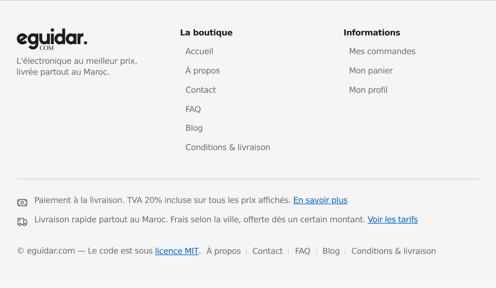
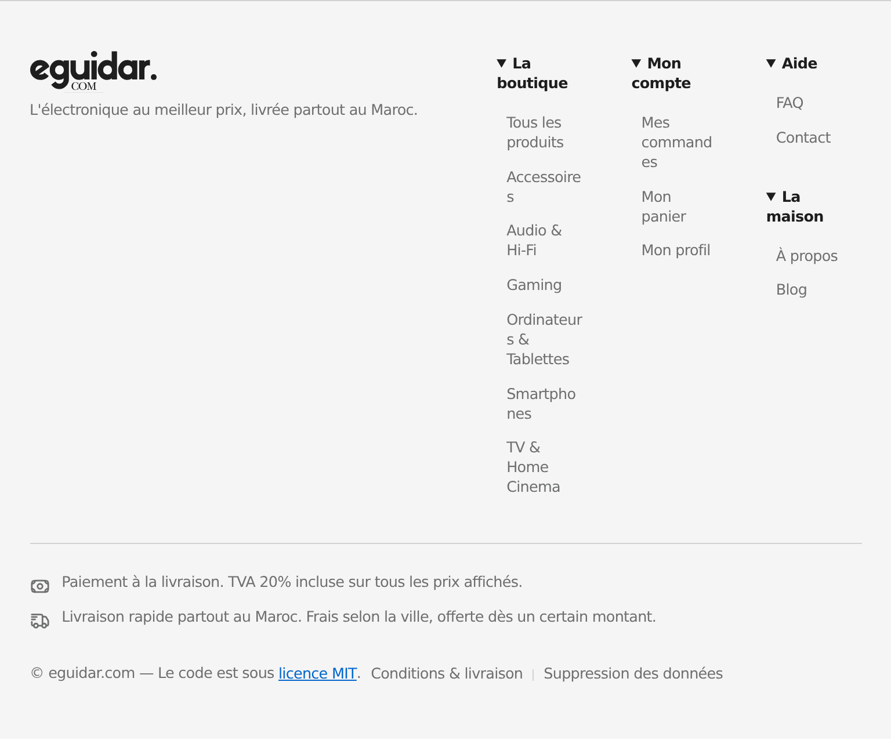
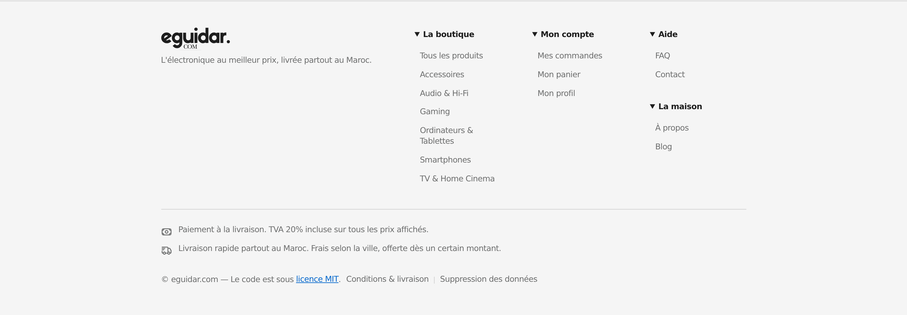

# Le Pied de page porte le Catalogue

Le Bandeau de navigation garde le Logo, l'entrée de Recherche et le déclencheur de l'Aperçu du
Panier. ADR-0051 lui a retiré les pages de la boutique et ADR-0037 lui a retiré les contrôles du
Compte. Reste une question que le code seul ne répond pas : où sont les six Structures, ces seules
portes vers les produits, quand un Client est en bas d'une page ? La recherche
[`apple-footer-ui.md`](../research/apple-footer-ui.md) §8 nomme « dupliquer la navigation
principale » un mode de défaillance — un pied qui recopie l'en-tête n'ajoute rien. Le Pied de page
ne recopie pourtant pas le Bandeau : il porte la taxonomy du Catalogue — les six Structures que le
Bandeau montre aussi — et non les pages que le Bandeau a cessé de porter. C'est cette différence que
la décision consigne.

## Décision

- **La section « La boutique » du Pied de page porte le Catalogue.** Elle rend *Tous les produits*
  (`/produits`), puis un lien par Structure (`/categorie/<slug>`) dans l'ordre de la lecture en cache
  que le Bandeau de navigation effectue dans le même rendu. Sans Structure, la section et sa colonne
  ne sont pas rendues : aucun titre ne reste au-dessus d'une liste vide.

- **Dupliquer ici la taxonomy du Bandeau est le bon choix pour cette boutique.** Le Catalogue a six
  Structures et autant de portes réelles ; le Pied de page est la seule surface qu'un Client atteint
  depuis n'importe quelle page sans la quitter, et le bas d'une page était jusqu'ici une impasse
  pleine de pages *à propos* de la boutique. Recopier une taxonomy n'est un défaut que lorsqu'on
  recopie des pages : les cinq pages statiques ont justement quitté le Bandeau (ADR-0051) et ne
  reviennent pas dans la section « La boutique ».

- **Le Bandeau de navigation ne gagne rien et ne perd rien.** Ses trois contrôles et son entrée vers
  le Compte restent exactement ceux d'ADR-0037 ; la lecture des Structures est la même que celle
  qu'il fait déjà, sans requête, sans tag de cache et sans schéma nouveaux. Le Pied de page reçoit
  les Structures par une prop optionnelle, vide par défaut, et reste un composant serveur sans
  lecture liée à la requête : ADR-0038 tient toujours.

- **L'annuaire garde sa loi.** Chaque destination n'y figure qu'une fois : les pages de la maison et
  d'aide ont leur propre section, les documents légaux restent seuls dans la rangée légale, et le
  Catalogue ne se dédouble pas en une liste de Produits. Le doublon que la recherche dénonce — les
  mêmes cinq liens dans une colonne et dans la rangée légale — est précisément ce que cette
  décision ne rétablit pas.

- **Le coût est une dépendance de lecture et une garde à maintenir.** Le layout de la Boutique lit
  les Structures et les passe au pied : la colonne « La boutique » n'est plus une constante du
  composant, et son test doit échouer si une destination réapparaît deux fois. La taxonomie est
  dupliquée dans l'affichage, pas dans la source : les deux surfaces partagent la même lecture, et
  c'est cette lecture unique qui empêche les libellés de diverger. Le pied gagne sept liens là où il
  n'en portait aucun pour les produits — c'est le prix de la porte en bas de page.

## Options envisagées

- **Mettre les six Structures dans le Bandeau à la place des pages** — rejeté : ADR-0051 a déjà
  refusé de recréer la rangée sous un autre nom, et le Bandeau est une barre, pas un annuaire.
- **Faire du Pied de page un plan du site du Bandeau** — rejeté : c'est le mode de défaillance
  §8 de la recherche, les cinq pages y apparaîtraient deux fois, et le pied n'ajouterait aucune
  porte vers les produits.
- **Écrire les six Structures en dur dans le composant du pied** — rejeté : la liste se délierait
  du Catalogue dès qu'une Structure change de nom ou de slug ; la lecture en cache déjà partagée
  avec le Bandeau coûte moins cher qu'une constante à surveiller.
- **Lier les Produits dans le pied** — rejeté : le §8 de la recherche nomme les liens par SKU une
  source de pourriture hebdomadaire ; le pied porte les familles stables, pas les articles.
- **Laisser le Catalogue au Bandeau et à la Recherche, sans entrée dans le pied** — rejeté : le
  Bandeau ne s'atteint qu'en haut de page, la Recherche demande un geste, et le bas de page resterait
  la surface la moins utile de la boutique.
- **Rouvrir ADR-0037 et remettre une entrée du Compte dans le Bandeau** — rejeté : la section
  « Mon compte » du pied est une destination d'annuaire, pas un contrôle de barre ; elle ne touche
  ni à l'Aperçu du Panier ni à son ordre d'entrées.

## Invariant

- Le Pied de page rend *Tous les produits* puis chaque Structure du Catalogue, une fois chacune, et
  ne rend ni la section ni la colonne quand le Catalogue est vide.
- Le Bandeau de navigation ne porte aucun contrôle du Compte et aucun lien vers les pages de la
  boutique ; il garde le même document à toute taille d'écran.
- Aucune destination du Pied de page n'apparaît deux fois dans le document rendu, et aucun document
  légal n'entre dans une colonne de navigation.
- Le Pied de page reste un composant serveur : la lecture des Structures est la seule que le layout
  ajoute, et elle est la même que celle du Bandeau.
- Cette décision ne crée ni route, ni schéma, ni requête, ni terme de glossaire ; elle amende
  [ADR-0037](0037-le-bandeau-na-plus-quune-entree-vers-le-compte.md) pour situer la section
  « Mon compte » du pied par rapport au Bandeau.

## Captures

Le même scénario — `/` en thème clair, six Structures de démonstration, élément `<footer>`, mouvement
réduit — est capturé avant et après le changement aux trois largeurs, avec la même échelle de
pixels. La révision avant est `f645386`, la révision après est `962ffd1` (annuaire fusionné de #1102
plus le câblage du Catalogue de #1109). Le Bandeau fixe est rendu statique pendant la capture pour
qu'il ne recouvre pas le pied sur les captures hautes ; le pied lui-même n'est pas modifié.

| Largeur | Avant | Après |
| --- | --- | --- |
| 390 px |  |  |
| 768 px |  |  |
| 1440 px |  |  |

## Amendement

[ADR-0065](0065-le-pied-de-page-prend-l-anatomie-d-apple-com.md) retire la colonne comme niveau de
données : une section est désormais une cellule de la grille, et la forme `colonnes` du §9.4 de la
spec laisse la place à une liste plate. La décision de cet ADR tient — sans Structure, la section et
sa porte ne sont pas rendues — et sa phrase « la section et sa colonne ne sont pas rendues » se lit
maintenant « la section et sa cellule ». Aucun autre point de cette décision ne change.
